<p align="center"><a href="README.md">Русский</a> &nbsp;|&nbsp; <b>English</b></p>

<a href="https://gb-ansar.vercel.app"></a>

<p align="center">
  <a href="#screens">In action&nbsp;›</a>&emsp;
  <a href="#features">Features&nbsp;›</a>&emsp;
  <a href="#how">How it works&nbsp;›</a>&emsp;
  <a href="#bot">Bot&nbsp;›</a>&emsp;
  <a href="#run">Run&nbsp;›</a>&emsp;
  <a href="#api">API&nbsp;›</a>
</p>

<br>


<br>
<br>

<p align="center">
  <i>«It just works.»</i><br>
  <sub>— Steve Jobs</sub>
</p>

<br>

<a name="screens"></a>


<a href="https://gb-ansar.vercel.app"></a>

<br>
<br>

<a name="features"></a>


<a href="frontend/app/camera.tsx">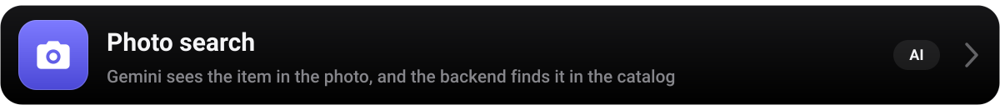</a>
<a href="frontend/app/barcode-scanner.tsx"></a>
<a href="frontend/app/catalog.tsx">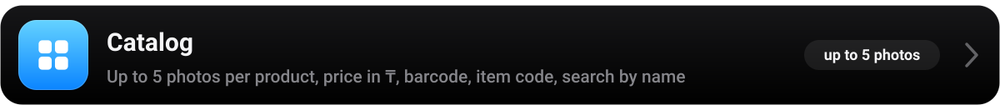</a>
<a href="frontend/app/submit-pending.tsx"></a>
<a href="frontend/app/search-stats.tsx">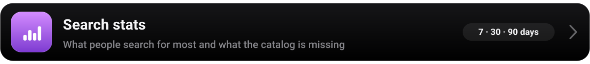</a>
<a href="backend/bot.py">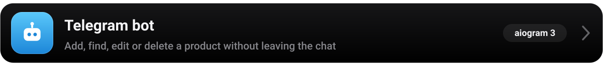</a>
<a href="frontend/public/manifest.json"></a>

<br>
<br>

<a name="how"></a>


<a href="backend/server.py"></a>

<br>
<br>


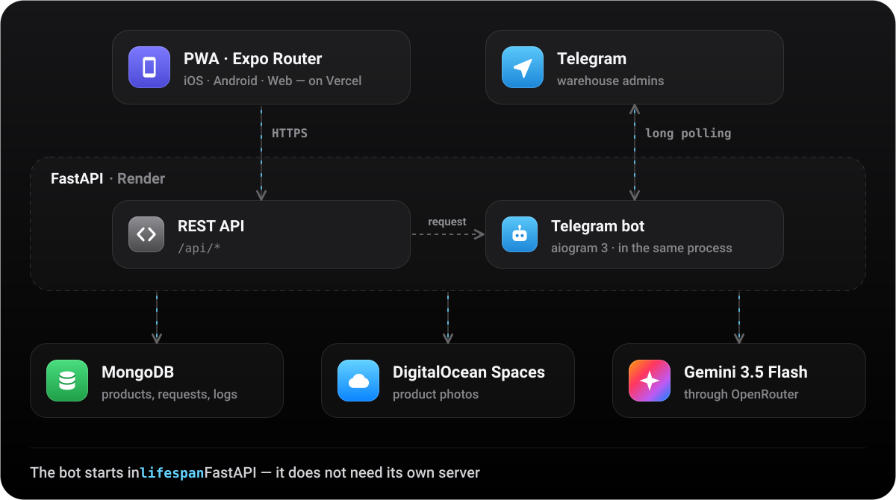

<br>
<br>

<a name="bot"></a>


<a href="backend/bot.py">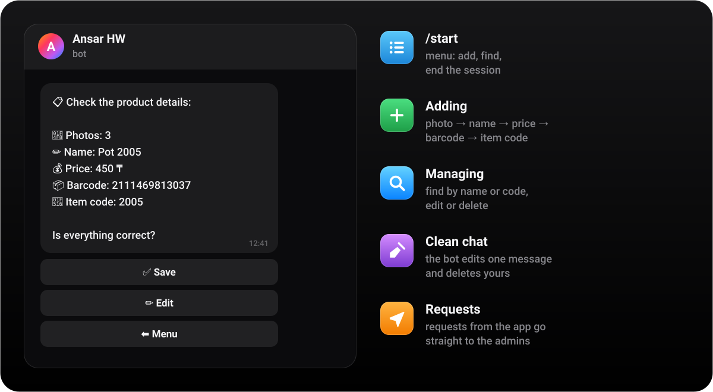</a>

<br>
<br>


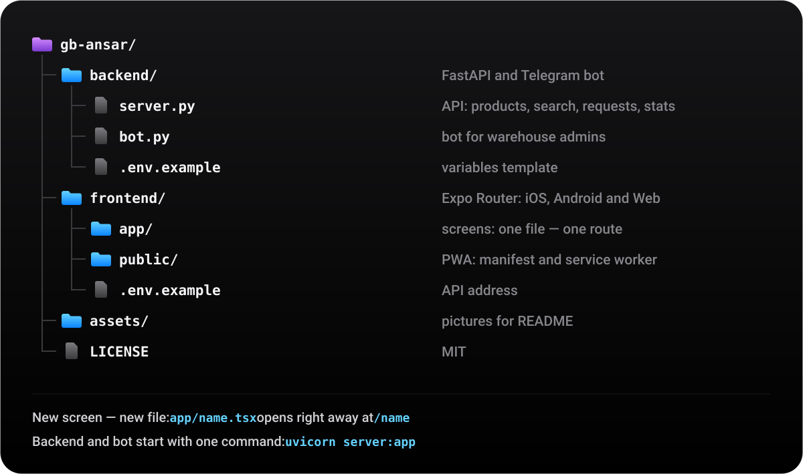

<br>
<br>

<a name="run"></a>


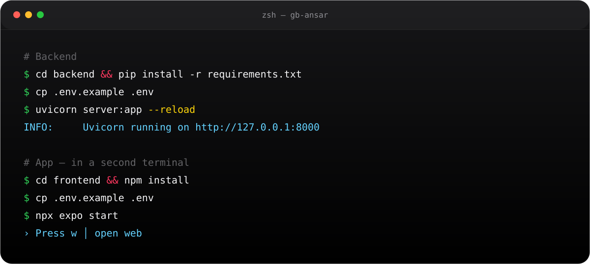

<details>
<summary>Copy the commands</summary>
<br>

```bash
# Backend
cd backend && pip install -r requirements.txt
cp .env.example .env        # add your keys
uvicorn server:app --reload # http://127.0.0.1:8000/docs

# App — in a second terminal
cd frontend && npm install
cp .env.example .env
npx expo start              # w — open in the browser
```

</details>

<br>


<a href="backend/.env.example">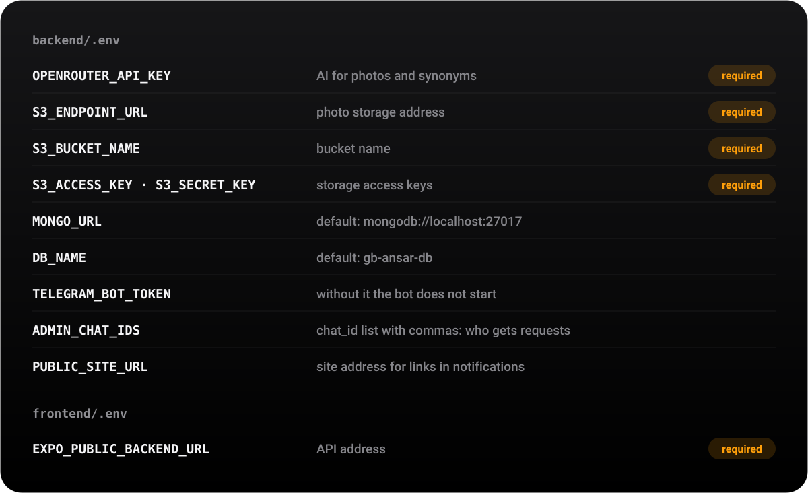</a>

<br>
<br>

<a name="api"></a>


<a href="backend/server.py">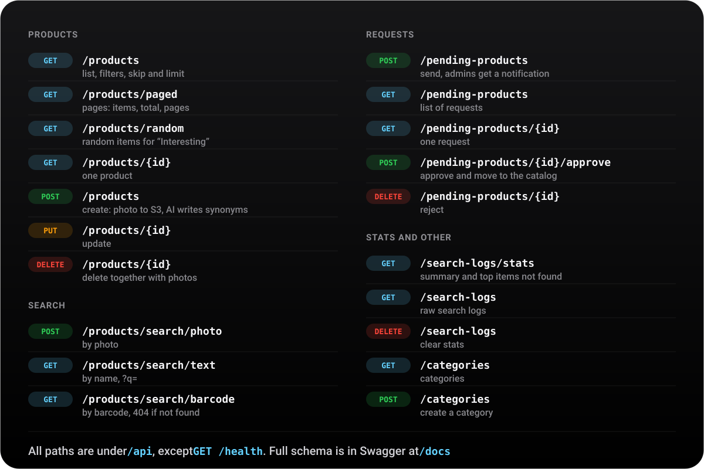</a>

<br>
<br>


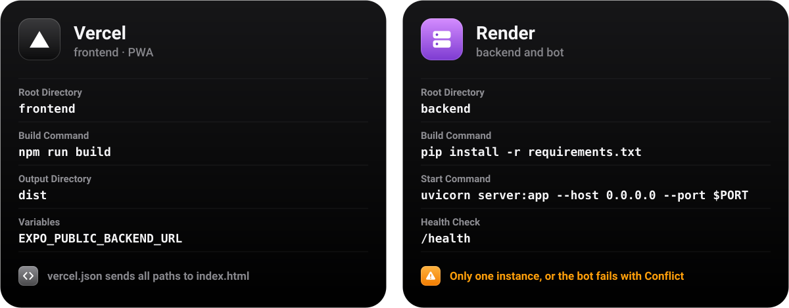

<br>
<br>



<br>
<br>


<p align="center">
  <sub>Made with ☕ for the Ansar HomeWear warehouse &nbsp;·&nbsp; <a href="https://instagram.com/ab.dussi">ab.dussi</a>, <a href="https://instagram.com/du.z.r">du.z.r</a> &nbsp;·&nbsp; <a href="LICENSE">MIT</a></sub>
</p>
