<p align="center"><b>Русский</b> &nbsp;|&nbsp; <a href="README.en.md">English</a></p>

<a href="https://gb-ansar.vercel.app"></a>

<p align="center">
  <a href="#screens">В деле&nbsp;›</a>&emsp;
  <a href="#features">Возможности&nbsp;›</a>&emsp;
  <a href="#how">Как работает&nbsp;›</a>&emsp;
  <a href="#bot">Бот&nbsp;›</a>&emsp;
  <a href="#run">Запуск&nbsp;›</a>&emsp;
  <a href="#api">API&nbsp;›</a>
</p>

<br>


<br>
<br>

<p align="center">
  <i>«It just works.»</i><br>
  <sub>— Steve Jobs</sub>
</p>

<br>

<a name="screens"></a>


<a href="https://gb-ansar.vercel.app">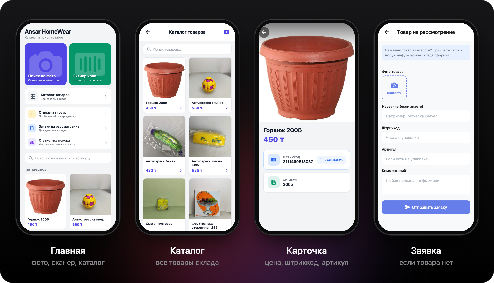</a>

<br>
<br>

<a name="features"></a>


<a href="frontend/app/camera.tsx">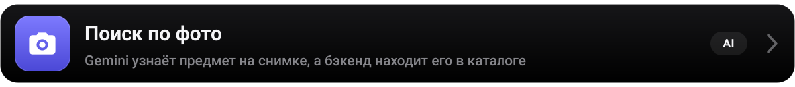</a>
<a href="frontend/app/barcode-scanner.tsx"></a>
<a href="frontend/app/catalog.tsx">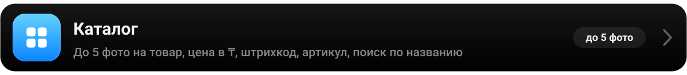</a>
<a href="frontend/app/submit-pending.tsx"></a>
<a href="frontend/app/search-stats.tsx">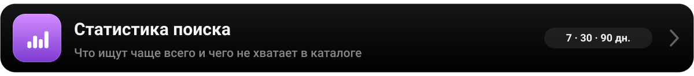</a>
<a href="backend/bot.py">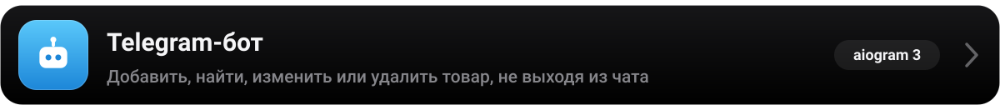</a>
<a href="frontend/public/manifest.json">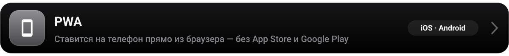</a>

<br>
<br>

<a name="how"></a>


<a href="backend/server.py"></a>

<br>
<br>


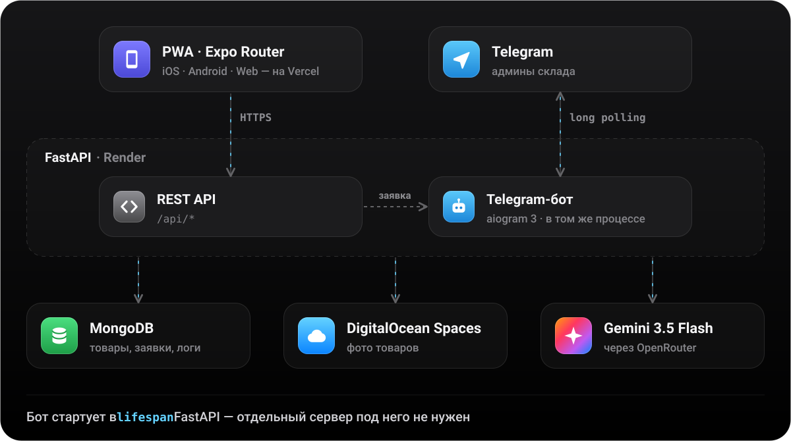

<br>
<br>

<a name="bot"></a>


<a href="backend/bot.py">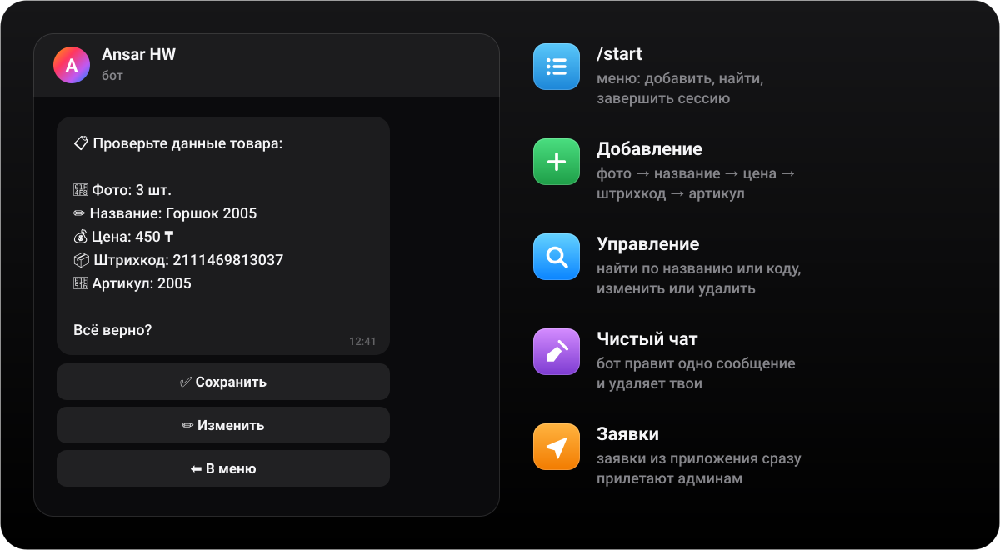</a>

<br>
<br>


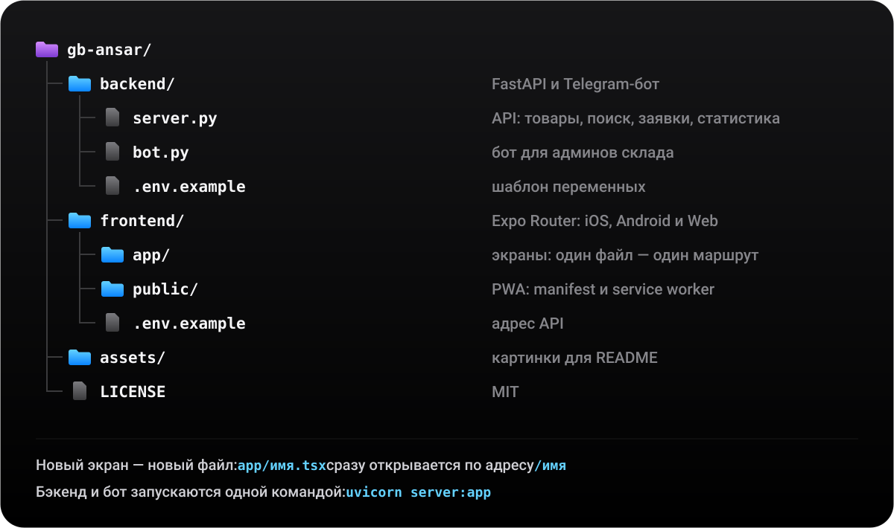

<br>
<br>

<a name="run"></a>


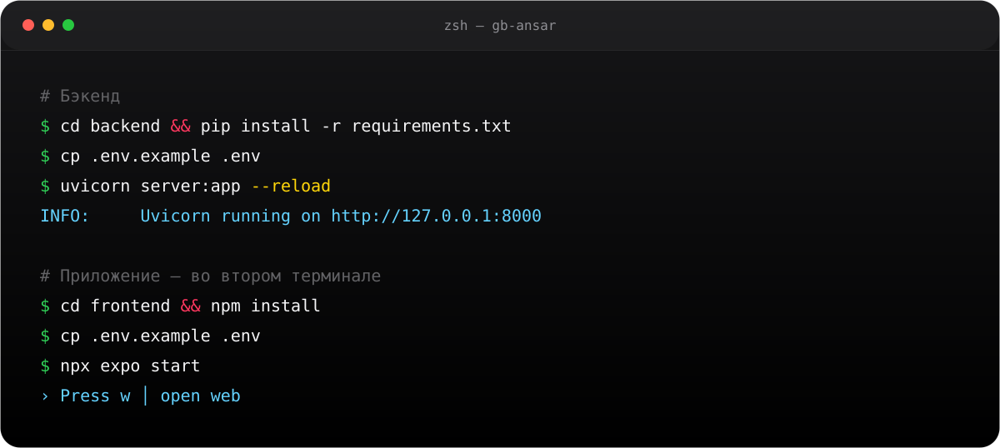

<details>
<summary>Скопировать команды</summary>
<br>

```bash
# Бэкенд
cd backend && pip install -r requirements.txt
cp .env.example .env        # впиши свои ключи
uvicorn server:app --reload # http://127.0.0.1:8000/docs

# Приложение — во втором терминале
cd frontend && npm install
cp .env.example .env
npx expo start              # w — открыть в браузере
```

</details>

<br>


<a href="backend/.env.example">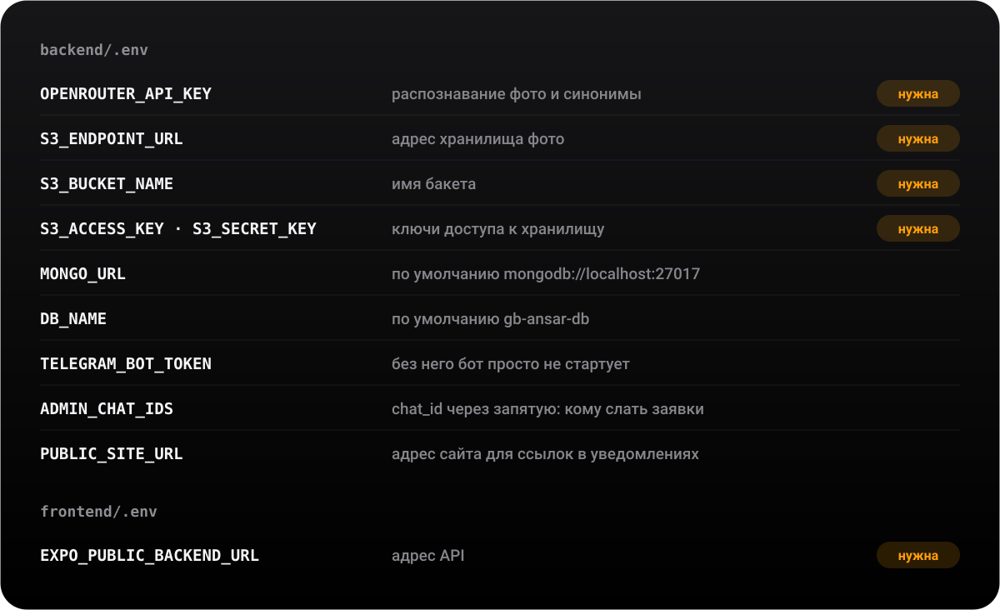</a>

<br>
<br>

<a name="api"></a>


<a href="backend/server.py">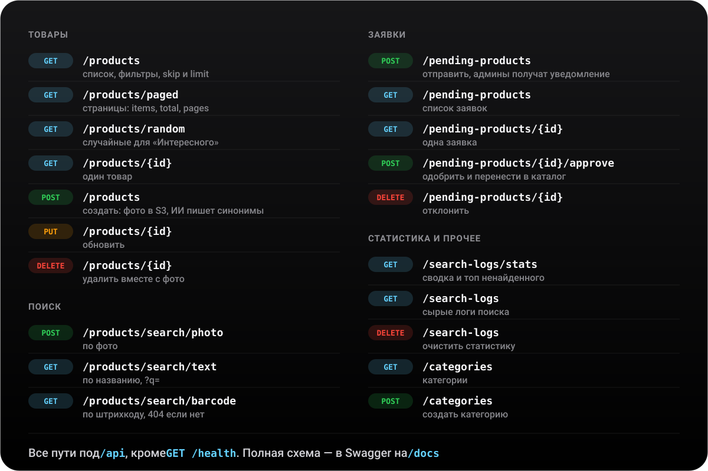</a>

<br>
<br>


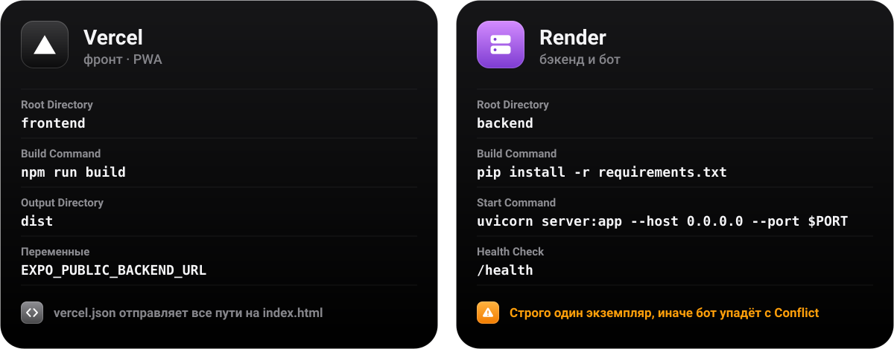

<br>
<br>



<br>
<br>


<p align="center">
  <sub>Сделано с ☕ для склада Ansar HomeWear &nbsp;·&nbsp; <a href="https://instagram.com/ab.dussi">ab.dussi</a>, <a href="https://instagram.com/du.z.r">du.z.r</a> &nbsp;·&nbsp; <a href="LICENSE">MIT</a></sub>
</p>
