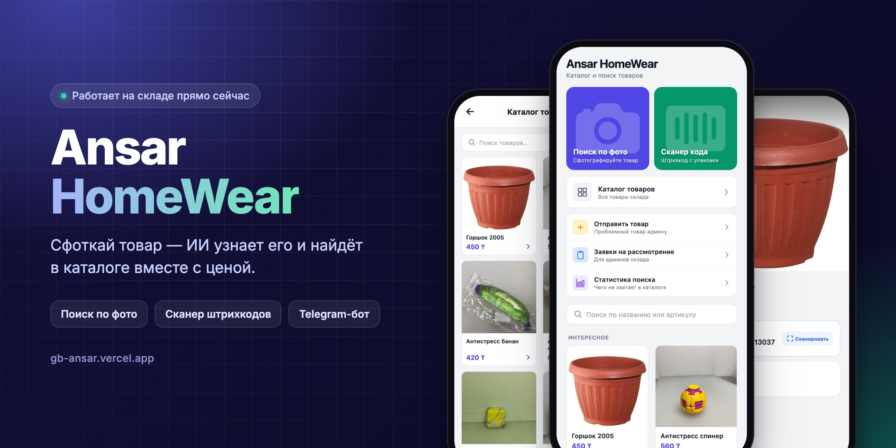
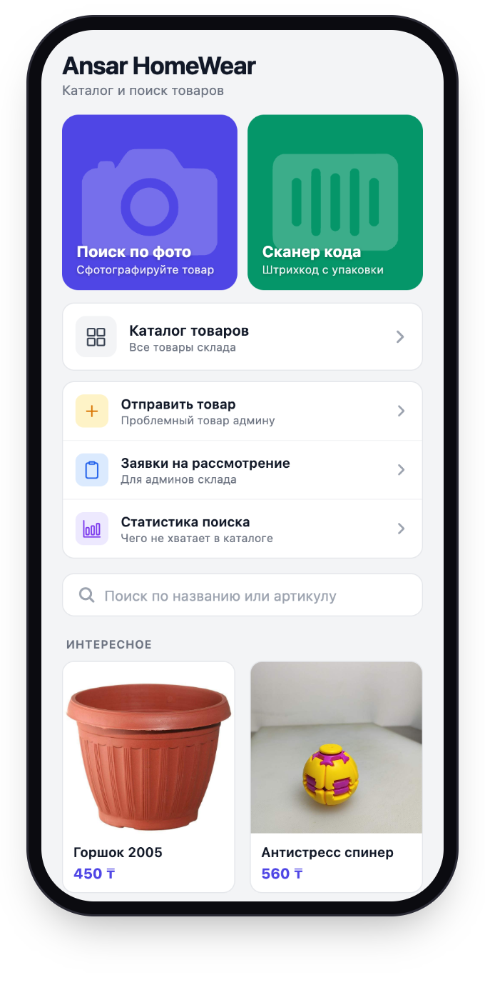
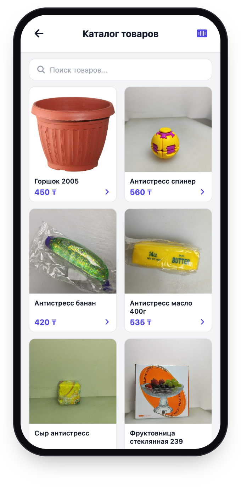
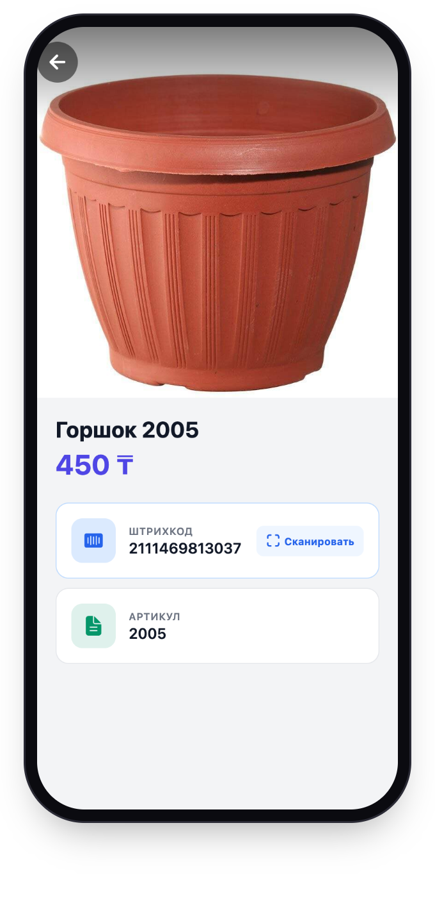
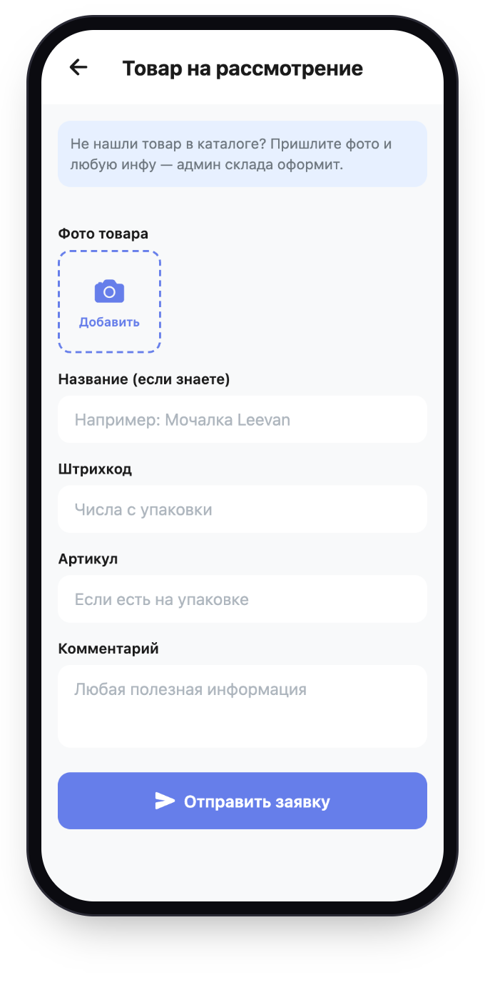
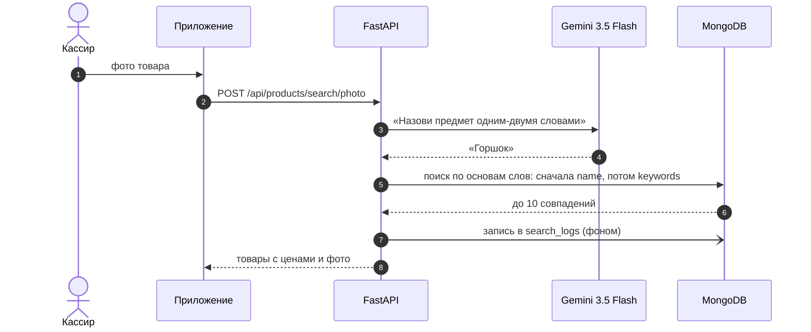
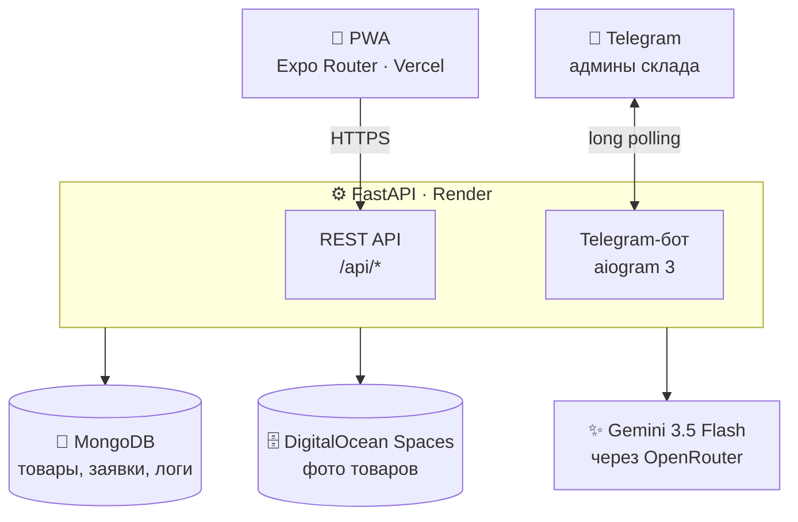

<div align="center">

<a href="https://gb-ansar.vercel.app"></a>

<h3>AI-каталог склада: сфоткал товар — узнал цену</h3>

<p>
  <a href="https://gb-ansar.vercel.app"></a>
</p>

<p>
  
  
  
  
  
  
  
  
</p>

<p>
  
  
  
  <a href="LICENSE"></a>
</p>

<a href="#-возможности">Возможности</a> · <a href="#-как-это-работает">Как это работает</a> · <a href="#-быстрый-старт">Быстрый старт</a> · <a href="#-api">API</a> · <a href="#-telegram-бот">Telegram-бот</a> · <a href="#-деплой">Деплой</a>

</div>

<br>

## 💡 Зачем это

На складе тысячи мелочей: горшки, антистрессы, фруктовницы, мочалки. У половины нет этикетки, и никто не помнит цену.

**Ansar HomeWear** решает это за пару секунд. Наводишь камеру на товар, ИИ понимает, что это «горшок», и приложение показывает все горшки из каталога с фото и ценами. Если товара в каталоге нет, сотрудник отправляет заявку, админ получает её в Telegram и заводит товар.

## ✨ Возможности

<table>
  <tr>
    <td width="50%" valign="top">📸 <b>Поиск по фото</b><br>Gemini называет предмет на снимке, бэкенд ищет его по названию и AI-синонимам</td>
    <td width="50%" valign="top">🏷️ <b>Сканер штрихкодов</b><br>EAN-13/8, UPC, Code128, QR, DataMatrix и ещё 7 форматов, прямо камерой телефона</td>
  </tr>
  <tr>
    <td valign="top">🗂️ <b>Каталог</b><br>До 5 фото на товар, цена в ₸, штрихкод, артикул, поиск по названию, подборка «Интересное»</td>
    <td valign="top">📨 <b>Заявки</b><br>«Не нашёл товар» → фото + комментарий → уведомление админам в Telegram со ссылкой</td>
  </tr>
  <tr>
    <td valign="top">📊 <b>Статистика поиска</b><br>Что ищут чаще всего и чего не хватает в каталоге за 7 / 30 / 90 дней</td>
    <td valign="top">🤖 <b>Telegram-бот</b><br>Добавить, найти, отредактировать или удалить товар, не выходя из чата</td>
  </tr>
  <tr>
    <td valign="top">📲 <b>PWA</b><br>Ставится на телефон как приложение прямо из браузера, без App Store</td>
    <td valign="top">⚡ <b>Один код на всё</b><br>Expo Router собирает iOS, Android и веб из одной кодовой базы</td>
  </tr>
</table>

## 📱 Скриншоты

<table align="center">
  <tr>
    <td align="center"><br><sub><b>Главная</b></sub></td>
    <td align="center"><br><sub><b>Каталог</b></sub></td>
    <td align="center"><br><sub><b>Карточка товара</b></sub></td>
    <td align="center"><br><sub><b>Заявка на товар</b></sub></td>
  </tr>
</table>

## 🧠 Как это работает

### Поиск по фото



- **Один вызов ИИ.** Модель только называет предмет. Цену, бренд и всё остальное берём из каталога, поэтому ИИ ничего не выдумывает.
- **Основы слов.** У длинных слов обрезаются окончания, поэтому «Горшки» находит «Горшок».
- **Два уровня поиска.** Сначала совпадения в названии. Если их мало, добираем из `keywords`: это 10 синонимов, которые ИИ генерирует по фото, когда товар добавляют в каталог.
- **Каждый запрос логируется.** Раздел «Статистика поиска» показывает, что люди ищут и не находят, то есть чего не хватает на складе.

### Архитектура



Бот живёт в том же процессе, что и API: поднимается в `lifespan` FastAPI и работает через long polling. Отдельный сервер под него не нужен. Когда в API приходит новая заявка, бот сразу пересылает её админам.

## 🧰 Стек

| Слой | Технологии |
|---|---|
| **Клиент** | Expo SDK 54, React Native 0.81, React 19, Expo Router 6, TypeScript, expo-camera, expo-image-picker |
| **Backend** | FastAPI, Motor (async MongoDB), Pydantic, httpx |
| **ИИ** | Google Gemini 3.5 Flash (vision) через OpenRouter |
| **Данные** | MongoDB, DigitalOcean Spaces (S3, aioboto3) |
| **Бот** | aiogram 3, Pillow (сжатие фото до 800 px) |
| **Хостинг** | Vercel (фронт), Render (бэкенд) |

## 📂 Структура

```
gb-ansar/
├── backend/
│   ├── server.py                # FastAPI: товары, поиск, заявки, статистика
│   ├── bot.py                   # Telegram-бот для админов
│   ├── requirements.txt
│   └── tests/                   # pytest
├── frontend/                    # Expo Router: один код для iOS, Android и Web
│   ├── app/
│   │   ├── index.tsx            # главная
│   │   ├── camera.tsx           # поиск по фото
│   │   ├── barcode-scanner.tsx  # сканер штрихкодов
│   │   ├── catalog.tsx          # каталог и поиск
│   │   ├── product-detail.tsx   # карточка товара
│   │   ├── add-product.tsx      # добавление товара
│   │   ├── edit-product.tsx     # редактирование
│   │   ├── submit-pending.tsx   # заявка «не нашёл товар»
│   │   ├── pending-list.tsx     # заявки на модерацию
│   │   ├── pending-detail.tsx   # одобрить / отклонить заявку
│   │   └── search-stats.tsx     # статистика поиска
│   ├── public/                  # PWA: manifest, service worker
│   └── vercel.json
└── docs/                        # картинки для README
```

## 🚀 Быстрый старт

Понадобятся **Python 3.11+**, **Node.js 20+**, **MongoDB** (локально или Atlas) и ключ **[OpenRouter](https://openrouter.ai/keys)**.

### 1. Backend

```bash
cd backend
python -m venv .venv && source .venv/bin/activate
pip install -r requirements.txt
cp .env.example .env        # впиши свои ключи
uvicorn server:app --reload
```

Swagger с документацией откроется на http://localhost:8000/docs.

### 2. Приложение

```bash
cd frontend
npm install
cp .env.example .env        # EXPO_PUBLIC_BACKEND_URL=http://127.0.0.1:8000
npx expo start
```

Дальше отсканируй QR в **Expo Go** или нажми <kbd>w</kbd>, чтобы открыть веб-версию.

> [!TIP]
> В браузере камера работает только по HTTPS или на `localhost`. Чтобы проверить сканер с телефона, используй `npx expo start --tunnel`.

### Переменные окружения

| Переменная | Где | Нужна | Зачем |
|---|---|:---:|---|
| `OPENROUTER_API_KEY` | backend | ✅ | распознавание фото и генерация синонимов |
| `S3_ENDPOINT_URL`, `S3_BUCKET_NAME`, `S3_ACCESS_KEY`, `S3_SECRET_KEY` | backend | ✅ | хранение фото товаров |
| `MONGO_URL` | backend | | по умолчанию `mongodb://localhost:27017` |
| `DB_NAME` | backend | | по умолчанию `gb-ansar-db` |
| `TELEGRAM_BOT_TOKEN` | backend | | без него бот просто не запускается |
| `ADMIN_CHAT_IDS` | backend | | chat_id через запятую: кому присылать заявки |
| `PUBLIC_SITE_URL` | backend | | адрес сайта для ссылок в уведомлениях |
| `EXPO_PUBLIC_BACKEND_URL` | frontend | ✅ | адрес API |

## 🔌 API

Все ручки под префиксом `/api`. Полная схема в Swagger: `/docs`.

<details>
<summary><b>Список эндпоинтов</b></summary>

<br>

**Товары**

| Метод | Путь | Что делает |
|---|---|---|
| `GET` | `/products` | список (фильтры `category`, `subcategory`, `skip`, `limit`) |
| `GET` | `/products/paged` | список с пагинацией: `items`, `total`, `pages` |
| `GET` | `/products/random` | случайные товары для «Интересного» |
| `GET` | `/products/{id}` | один товар |
| `POST` | `/products` | создать: 1–5 фото уходят в S3, ИИ генерирует синонимы |
| `PUT` | `/products/{id}` | обновить |
| `DELETE` | `/products/{id}` | удалить вместе с фото в S3 |

**Поиск**

| Метод | Путь | Что делает |
|---|---|---|
| `POST` | `/products/search/photo` | поиск по фото (`image_base64`) |
| `GET` | `/products/search/text?q=` | по названию |
| `GET` | `/products/search/barcode?barcode=` | по штрихкоду, `404` если нет |

**Заявки**

| Метод | Путь | Что делает |
|---|---|---|
| `POST` | `/pending-products` | отправить заявку, админы получат уведомление |
| `GET` | `/pending-products` | список заявок |
| `GET` | `/pending-products/{id}` | одна заявка |
| `POST` | `/pending-products/{id}/approve` | одобрить и перенести в каталог |
| `DELETE` | `/pending-products/{id}` | отклонить |

**Статистика и прочее**

| Метод | Путь | Что делает |
|---|---|---|
| `GET` | `/search-logs/stats?days=7` | сводка: всего, найдено, топ ненайденных |
| `GET` | `/search-logs` | сырые логи поиска |
| `DELETE` | `/search-logs` | очистить статистику |
| `GET` | `/categories` | категории |
| `POST` | `/categories` | создать категорию |
| `GET` | `/health` | health-check (без префикса `/api`) |

</details>

## 🤖 Telegram-бот

Бот нужен админам склада, чтобы вести каталог прямо с телефона.

- **`/start`** открывает меню: ➕ Добавить товар / 🔍 Найти товар. **`/stop`** завершает сессию.
- **Добавление:** фото (можно несколько) → название → цена → штрихкод → артикул → проверка → сохранить. Любой шаг можно поправить перед сохранением.
- **Управление:** найти по названию или штрихкоду, открыть карточку, изменить любое поле или удалить товар.
- **Чистый чат:** бот редактирует одно сообщение-«экран» вместо того, чтобы засыпать чат новыми, а сообщения пользователя удаляет.
- **Заявки:** когда сотрудник отправляет «не нашёл товар», все из `ADMIN_CHAT_IDS` получают фото и ссылку на заявку.

## 🚢 Деплой

**Frontend на Vercel**

| Настройка | Значение |
|---|---|
| Root Directory | `frontend` |
| Build Command | `npm run build` |
| Output Directory | `dist` |
| Env | `EXPO_PUBLIC_BACKEND_URL` |

`vercel.json` уже переписывает все пути на `index.html`, так что прямые ссылки вроде `/product-detail?productId=…` работают.

**Backend на Render**

| Настройка | Значение |
|---|---|
| Root Directory | `backend` |
| Build Command | `pip install -r requirements.txt` |
| Start Command | `uvicorn server:app --host 0.0.0.0 --port $PORT` |
| Health Check | `/health` |

> [!IMPORTANT]
> Запускай бэкенд в **одном** экземпляре. Telegram не даёт двум процессам одновременно получать обновления одного бота, и второй упадёт с ошибкой `Conflict`.

## 🧭 Roadmap

- [x] Поиск по фото, штрихкоду и названию
- [x] Заявки с уведомлениями в Telegram
- [x] Статистика поиска
- [x] PWA с установкой на телефон
- [ ] Авторизация для админских разделов
- [ ] Распознавание нескольких товаров на одном фото (полка целиком)
- [ ] Офлайн-поиск: CLIP-эмбеддинги + FAISS
- [ ] Интерфейс на казахском и английском
- [ ] Импорт каталога из CSV / Excel

## 📄 Лицензия

[MIT](LICENSE)

## 👥 Авторы

<table>
  <tr>
    <td align="center"><a href="https://instagram.com/ab.dussi"><b>ab.dussi</b></a></td>
    <td align="center"><a href="https://instagram.com/du.z.r"><b>du.z.r</b></a></td>
  </tr>
</table>

<div align="center">
<br>
<sub>Сделано для склада <b>Ansar HomeWear</b> 🇰🇿</sub>
</div>
